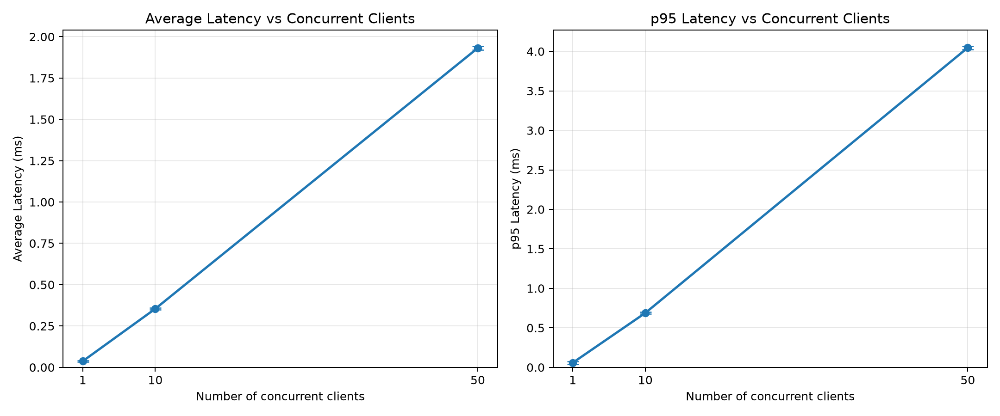
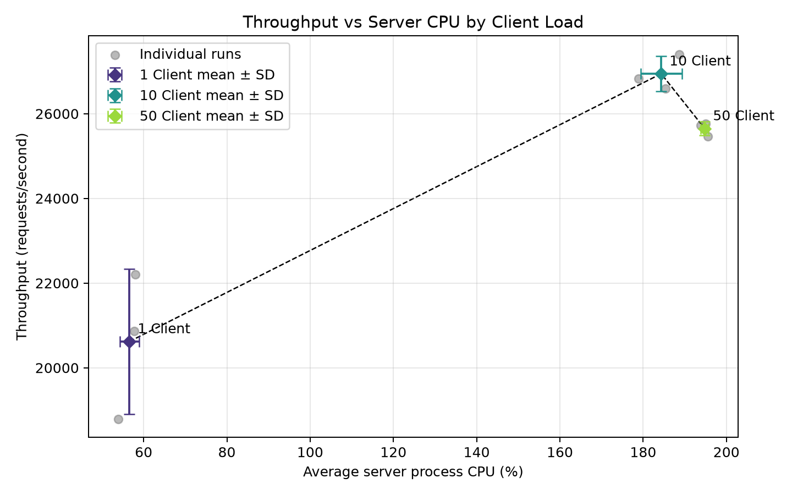

# **Kết quả thực nghiệm và phân tích**

## **1. Mục tiêu**
Phân tích dữ liệu đo hiệu năng TCP Server ở ba mức tải 1, 10 và 50 Client; đánh giá throughput, latency, tỷ lệ lỗi và mức sử dụng CPU. Mỗi mức Client được thực hiện 3 lần để quan sát tính ổn định của kết quả.

## **2. Phương pháp và định nghĩa chỉ số**
Chỉ sử dụng các bản ghi có `phase = measure` trong từng file `loadgen_c*_r*.csv` để tính chỉ số hiệu năng; các bản ghi `warmup` không được đưa vào throughput và latency của pha đo.
- **Total Requests**: số bản ghi trong pha `measure`.
- **Successful Requests**: số bản ghi pha `measure` có `status = ok`.
- **Failed Requests**: tổng request pha đo trừ số request thành công.
- **Throughput**: số request thành công chia cho thời gian đo 20 giây, đơn vị request/giây (req/s).
- **Error Rate**: số request thất bại chia tổng request pha đo, nhân 100%.
- **Average Latency**: trung bình `latency_ms` của request thành công trong pha đo.
- **P95 Latency**: phân vị 95% của `latency_ms` của request thành công trong pha đo.
- **CPU Server Average**: trung bình `cpu_server_avg_pct` theo ba lần chạy ở mỗi mức Client, lấy từ `per_run_summary.csv`. Giá trị CPU tiến trình có thể vượt 100% khi sử dụng nhiều hơn một logical core.

## **3. Kết quả thực nghiệm**

### **3.1. Bảng tổng hợp theo số Client**
| Số Client | Throughput trung bình (req/s) | Độ lệch chuẩn throughput | Average Latency (ms) | P95 Latency (ms) | CPU Server trung bình (%) | CPU Load Generator trung bình (%) | Error Rate pha đo |
|---:|---:|---:|---:|---:|---:|---:|---:|
| 1 | 20,621.08 | 1,717.76 | 0.0373 | 0.0580 | 56.59 | 57.54 | 0% |
| 10 | 26,943.77 | 415.17 | 0.3544 | 0.6883 | 184.33 | 196.85 | 0% |
| 50 | 25,649.35 | 162.73 | 1.9315 | 4.0470 | 194.79 | 196.79 | 0% |
Độ lệch chuẩn throughput được tính giữa ba lần chạy ở cùng mức tải (sample standard deviation).

### **3.2. Throughput từng lần chạy**
| Số Client | Lần 1 (req/s) | Lần 2 (req/s) | Lần 3 (req/s) | Trung bình (req/s) |
|---:|---:|---:|---:|---:|
| 1 | 18,794.50 | 20,864.75 | 22,204.00 | 20,621.08 |
| 10 | 26,599.45 | 27,404.80 | 26,827.05 | 26,943.77 |
| 50 | 25,721.30 | 25,763.70 | 25,463.05 | 25,649.35 |

### **3.3. CPU Server**
| Số Client | CPU Server trung bình (%) | CPU Server lớn nhất trung bình qua 3 lần (%) | CPU quy đổi trên 12 logical cores (%) |
|---:|---:|---:|---:|
| 1 | 56.59 | 71.83 | 4.72 |
| 10 | 184.33 | 220.60 | 15.36 |
| 50 | 194.79 | 237.23 | 16.23 |
CPU quy đổi trên tổng số logical cores được lấy từ cột `cpu_server_avg_pct_of_total` trong `per_run_summary.csv`; không đồng nhất chỉ số này với CPU tiến trình.

### **3.4. Average Latency và p95 Latency theo số Client**
Biểu đồ thể hiện trung bình của từng chỉ số latency qua ba lần chạy tại mỗi mức tải. Thanh sai số biểu thị độ lệch chuẩn mẫu giữa ba lần chạy (sample standard deviation), không phải khoảng tin cậy.

### **3.5. Mối tương quan giữa Throughput và CPU Server**
Mỗi điểm nhỏ biểu diễn một lần chạy; hình thoi và thanh sai số thể hiện trung bình cùng độ lệch chuẩn mẫu của Throughput và CPU tiến trình Server ở mức Client tương ứng. Các lượt chạy được ghép theo cùng `clients` và `run`.

### **3.6. Số lượng request**
Trong 9 lượt chạy, tổng cộng có **4,392,852 request ở pha đo**. Cả 4,392,852 request đều có `status = ok`; không có request thất bại trong pha đo. Vì vậy, error rate tính theo các bản ghi CSV của pha đo là 0%.

Trong dữ liệu warm-up có ghi nhận 3 `socket_error` ở lượt 50 Client lần 2 và 2 `socket_error` ở lượt 50 Client lần 3. Các lỗi warm-up này không thuộc pha đo chính thức và không được cộng vào error rate pha đo. Nên giữ thông tin này trong hồ sơ kiểm thử thay vì kết luận rằng toàn bộ quá trình không từng phát sinh lỗi.

## **4. Phân tích và nhận xét**
### **4.1. Throughput theo số Client**
Throughput tăng từ 20,621.08 req/s ở 1 Client lên 26,943.77 req/s ở 10 Client, tương đương tăng khoảng **30.66%**. Việc tăng số Client từ 1 lên 10 giúp hệ thống khai thác khả năng xử lý đồng thời tốt hơn trong điều kiện thử nghiệm này.

Khi tăng từ 10 lên 50 Client, throughput trung bình giảm còn 25,649.35 req/s, tương đương giảm khoảng **4.80%** so với mức 10 Client. Điều này cho thấy throughput không tiếp tục tăng tuyến tính theo số Client; trong cấu hình và môi trường đo hiện tại, mức 10 Client cho throughput trung bình cao nhất trong ba mức được thử.

### **4.2. Latency theo số Client**
Average Latency tăng từ 0.0373 ms (1 Client) lên 0.3544 ms (10 Client), sau đó tăng lên 1.9315 ms (50 Client). P95 Latency cũng tăng từ 0.0580 ms lên 0.6883 ms và 4.0470 ms tương ứng.

Đặc biệt, khi tăng từ 10 lên 50 Client, throughput chỉ giảm khoảng 4.80% nhưng Average Latency tăng khoảng 5.45 lần. Điều này cho thấy tải đồng thời cao hơn làm thời gian phản hồi của request tăng rõ rệt, dù số request xử lý mỗi giây chưa giảm mạnh.

### **4.3. CPU và tài nguyên máy**
CPU Server trung bình tăng từ 56.59% ở 1 Client lên 184.33% ở 10 Client và 194.79% ở 50 Client. CPU tiến trình vượt 100% là có thể xảy ra khi tiến trình sử dụng nhiều logical core; không nên diễn giải 184% hoặc 195% là phần trăm vượt quá tổng công suất toàn máy.

Đồng thời, CPU Load Generator trung bình đạt 196.85% ở 10 Client và 196.79% ở 50 Client. Vì Load Generator và Server chạy cùng máy, cả hai tiến trình cùng cạnh tranh CPU. Đây là yếu tố có thể ảnh hưởng đến throughput và latency, do đó cần thận trọng khi quy toàn bộ thay đổi hiệu năng cho riêng TCP Server.

### **4.4. Độ ổn định giữa các lần chạy**
Độ lệch chuẩn throughput là 1,717.76 req/s ở 1 Client, 415.17 req/s ở 10 Client và 162.73 req/s ở 50 Client. Mức 1 Client có độ dao động tương đối lớn hơn giữa ba lần chạy; mức 10 và 50 Client có kết quả throughput gần nhau hơn. Tuy nhiên, mỗi mức chỉ có ba lần lặp nên số lần chạy còn hạn chế để khẳng định độ ổn định dài hạn.

### **4.5. Mối tương quan giữa Throughput và CPU**
Khi tăng từ 1 lên 10 Client, CPU Server trung bình tăng từ 56.59% lên 184.33%, đồng thời Throughput tăng từ 20,621.08 lên 26,943.77 req/s. Tăng tiếp lên 50 Client làm CPU trung bình chỉ tăng nhẹ lên 194.79%, trong khi Throughput giảm còn 25,649.35 req/s. Như vậy, CPU tăng đi kèm với Throughput tăng trong khoảng 1–10 Client, nhưng xu hướng này không tiếp tục ở 50 Client; dữ liệu gợi ý Throughput đã gần vùng bão hòa trong các mức tải đã thử. Vì chỉ có ba lần chạy ở mỗi mức và Server/Load Generator cùng chạy trên một máy, quan sát này mô tả mối liên hệ trong thí nghiệm, không chứng minh quan hệ nhân quả.

## **5. Giới hạn thực nghiệm**
1. **Server và Load Generator chạy cùng máy**: CPU hai tiến trình cạnh tranh tài nguyên. Nên thực hiện thêm phép đo trên hai máy riêng biệt hoặc dùng máy tạo tải độc lập để giảm ảnh hưởng này.
2. **Chỉ thử ba mức Client**: các mức 1, 10 và 50 chưa đủ để xác định chính xác ngưỡng bão hòa. Có thể bổ sung các mức trung gian và cao hơn trong các lần thử sau.
3. **Chỉ có ba lần lặp mỗi mức**: nên tăng số lần lặp nếu cần đánh giá độ ổn định và khoảng tin cậy tốt hơn.
4. **Phạm vi mạng loopback**: phép thử dùng `127.0.0.1`, không phản ánh đầy đủ độ trễ, mất gói hoặc giới hạn của mạng LAN/WAN thực tế.
5. **Khác biệt giữa tài liệu và triển khai**: `docs/protocal-spec.md` mô tả length-prefixed binary framing, trong khi `src/server/server.py` và `src/load-generator/client.py` trong gói hiện tại triển khai newline-delimited JSON. Vì vậy, kết quả này đánh giá triển khai JSON-line hiện có, không nên mô tả là kết quả benchmark cho giao thức framing nhị phân trong tài liệu.
6. **Lỗi trong warm-up**: có 5 `socket_error` ở warm-up tại hai lượt 50 Client. Dù không nằm trong pha đo, cần kiểm tra nguyên nhân nếu nhóm muốn mô tả quá trình chạy là hoàn toàn không có lỗi.

## **6. Kết luận**
Trong phạm vi thực nghiệm hiện tại, mức 10 Client đạt throughput trung bình cao nhất với 26,943.77 req/s. Khi tăng lên 50 Client, throughput giảm khoảng 4.80%, trong khi Average Latency tăng khoảng 5.45 lần so với mức 10 Client và CPU Server trung bình tăng nhẹ. Kết quả gợi ý hệ thống bắt đầu có dấu hiệu đạt vùng bão hòa về throughput trong khoảng tải đã thử, đồng thời độ trễ tăng đáng kể ở mức 50 Client.

Tuy nhiên, do Server và Load Generator chạy chung một máy, phép đo dùng loopback và số mức tải/lần lặp còn hạn chế, kết luận về giới hạn hiệu năng cần được xem là kết luận trong điều kiện thử nghiệm này. Cần kiểm thử bổ sung trên môi trường tách máy và nhiều mức tải hơn để xác định ngưỡng chịu tải đáng tin cậy.